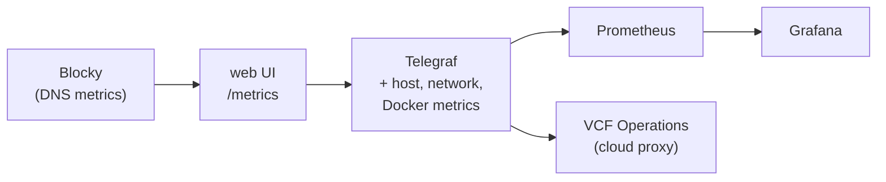

# Monitoring: Grafana, Prometheus, Telegraf, VCF Operations

lanjaeger's web UI exports its numbers at `/metrics` in Prometheus format. You can use them in three ways:

| Option | What you get | Effort |
|---|---|---|
| [A. Built-in Grafana](#a-built-in-grafana) | Telegraf + Prometheus + Grafana on the lanjaeger server, with a ready-made dashboard | two lines in `.env` |
| [B. Your own Prometheus / Grafana](#b-your-own-prometheus-and-grafana) | Scrape `/metrics`, import the dashboard | a scrape job |
| [C. VCF Operations](#c-vcf-operations) | Open-source Telegraf on the Docker host, sending to VCF Operations via the cloud proxy | Telegraf install + helper script |



## What's measured

| Area | Metrics | Source |
|---|---|---|
| **Traffic** | `lanjaeger_bytes_sent_to_clients_total` (outbound to the LAN), `lanjaeger_bytes_from_internet_total` (inbound, cache misses), `lanjaeger_bytes_from_cache_total`, `lanjaeger_cache_hit_ratio`, `lanjaeger_download_rate_bytes`; per game service `lanjaeger_service_bytes_total{service,status}` | web UI |
| **Clients** | `lanjaeger_clients_seen` (devices served), `lanjaeger_clients_active` (downloading now), per device `lanjaeger_client_bytes_total{client,status}` | web UI |
| **Health** | `lanjaeger_container_up{service}`, `lanjaeger_container_healthy{service}`, `lanjaeger_containers_unhealthy`, `lanjaeger_alerts_active`, `lanjaeger_dns_up` | web UI |
| **Prefill** | `lanjaeger_prefill_games{service}` (how many), `lanjaeger_prefill_game_timestamp_seconds{service,id,name}` (which, and when), `lanjaeger_prefill_last_run_success`, `lanjaeger_prefill_logged_in`, `lanjaeger_prefill_steam_depots` | web UI |
| **Cache disk** | `lanjaeger_cache_size_bytes`, `lanjaeger_cache_limit_bytes`, `lanjaeger_cache_filesystem_{size,free}_bytes` | web UI |
| **DNS / ad blocking** | `blocky_query_total`, `blocky_response_total{response_type}` (BLOCKED, CACHED, …), `blocky_blocking_enabled`, `blocky_denylist_cache_entries` | Blocky, passed on by the web UI |
| **Network interfaces** | `net_bytes_recv`, `net_bytes_sent`, `net_err_*`, `net_drop_*` per interface | Telegraf |
| **Host** | CPU, memory, load, disk usage, disk I/O | Telegraf |
| **Containers** | CPU, memory, network, block I/O per container | Telegraf (Docker) |

Notes:
- **Counters** (`…_total`) count traffic since the web UI last started. When the web UI starts, it replays the end of the existing access log for its own dashboard, but that replay isn't counted again here. The `lanjaeger_window_*` gauges and `lanjaeger_clients_seen` cover the web UI's whole statistics window.
- **Prefilled games:** Epic and Battle.net record every game they finish. Steam only records depots, which can't be mapped back to games offline. So for Steam, lanjaeger lists the games you picked by name in the web UI, once a run including them exits successfully. Games prefilled through "all owned", "recently played" or "top games" only show up in `lanjaeger_prefill_steam_depots`.
- **Privacy:** the metrics contain client IPs and game names, but no DNS queries or websites. `/metrics` needs a token.

## Turn the endpoint on

In `.env`:

```bash
METRICS_TOKEN=<random>        # e.g. openssl rand -hex 24
```

then `docker compose up -d`. Test it:

```bash
curl -H "Authorization: Bearer <token>" http://<server>:8080/metrics
```

Without `METRICS_TOKEN` the endpoint is off (404).

## A. Built-in Grafana

```bash
COMPOSE_PROFILES=webui,monitoring
METRICS_TOKEN=<random>
DOCKER_GID=<output of: stat -c %g /var/run/docker.sock>
GRAFANA_PASSWORD=<password>   # optional, defaults to WEBUI_PASSWORD
GRAFANA_PUBLIC=false          # true = view without sign-in, e.g. on a screen at the party
```

`docker compose up -d`, then open `http://<server>:3000` and sign in as `admin`. The **lanjaeger** dashboard is the home page:

- **Overview:** sent to clients, from the internet, share served from cache, clients served, downloading now, current rate, unhealthy containers, alerts.
- **Traffic:** hit/miss over time, network interfaces (in/out), per game service, top clients, network errors and drops.
- **DNS and ad blocking:** answers by type, blocking on/off, blocked share, blocklist size.
- **Health:** container timeline, container CPU/memory, host CPU/memory, disk throughput, cache disk.
- **Prefill:** games per service, last run, logged in, and a table of every prefilled game with its date.

Three containers are added, all on the host network: Telegraf and Prometheus listen on `127.0.0.1` only; Grafana listens on `GRAFANA_BIND_IP` (default: `WEBUI_BIND_IP`) port `GRAFANA_PORT` (3000). Prometheus keeps `METRICS_RETENTION` (90 days) in the `prometheus-data` volume.

## B. Your own Prometheus and Grafana

Scrape the web UI directly:

```yaml
scrape_configs:
  - job_name: lanjaeger
    authorization:
      credentials: <METRICS_TOKEN>
    static_configs:
      - targets: ["192.168.10.10:8080"]
```

For the host, network and container panels you also need Telegraf's metrics. Run the `monitoring` profile's Telegraf only (`docker compose up -d telegraf`) and scrape it, or use your own Telegraf with [`monitoring/telegraf/telegraf.d/`](monitoring/telegraf/telegraf.d/). Then import [`monitoring/grafana/dashboards/lanjaeger.json`](monitoring/grafana/dashboards/lanjaeger.json) (Dashboards → New → Import) and pick your Prometheus data source.

Telegraf's Prometheus output listens on `127.0.0.1:9273`. For a Prometheus on another machine, change `listen` in `prometheus-output.conf` to the server's LAN IP.

## C. VCF Operations

VCF Operations takes metrics from **open-source Telegraf** installed on the monitored machine, configured by a helper script from your **cloud proxy**. lanjaeger's Telegraf files only add input plugins, so they fit next to whatever the script writes.

> **Status:** written against the Aria Operations 8.x documentation and Broadcom KB articles on open-source Telegraf. I couldn't find docs specific to VCF Operations 9.1.1 for this, and I haven't tested it against a VCF Operations instance. Check each step against your version's documentation ("Monitoring applications using open source Telegraf").

**Prerequisites:** a cloud proxy that is online, and the Docker host able to reach it on ports 443 and 8443 (IPv4). The host needs `uuidgen`. Don't run the `monitoring` profile's Telegraf at the same time (it's fine to run Prometheus and Grafana).

1. **Install Telegraf on the host** from the [InfluxData repository](https://docs.influxdata.com/telegraf/v1/install/) (package `telegraf`).
2. **Give it Docker access and lanjaeger's settings:**
   ```bash
   sudo usermod -aG docker telegraf
   sudo tee -a /etc/default/telegraf <<'EOF'
   LANJAEGER_METRICS_URL=http://192.168.10.10:8080/metrics
   METRICS_TOKEN=<METRICS_TOKEN from lanjaeger's .env>
   EOF
   ```
3. **Add lanjaeger's inputs:**
   ```bash
   sudo cp /opt/lanjaeger/monitoring/telegraf/telegraf.d/lanjaeger-host.conf \
           /opt/lanjaeger/monitoring/telegraf/telegraf.d/lanjaeger-app.conf /etc/telegraf/telegraf.d/
   ```
   In `/etc/telegraf/telegraf.d/lanjaeger-app.conf`, uncomment the `fieldexclude` line. This leaves out the per-client and per-game series, which would otherwise become hundreds of separate metrics in VCF Operations. Use Grafana for those.
   For Grafana on the same host as well, also copy `prometheus-output.conf`.
4. **Connect Telegraf to VCF Operations.** Download the helper script from the cloud proxy and run it in open-source mode, as in Broadcom [KB 442680](https://knowledge.broadcom.com/external/article/442680/for-linux-machines-physical-or-virtual-y.html):
   ```bash
   curl -kO https://<cloud-proxy>/downloads/salt/telegraf-utils.sh
   sed -i 's/\r$//' telegraf-utils.sh            # if it fails with "$'\r': command not found"
   chmod +x telegraf-utils.sh
   # token: POST https://<vcf-ops>/suite-api/api/auth/token/acquire
   sudo ./telegraf-utils.sh opensource -c <cloud-proxy-ip> -t <token> -d /etc/telegraf/telegraf.d \
        -e /usr/bin/telegraf -v <vcf-ops-fqdn>
   sudo systemctl restart telegraf
   ```
5. **Check it collects:** `sudo -u telegraf telegraf --config /etc/telegraf/telegraf.conf --config-directory /etc/telegraf/telegraf.d --test --input-filter prometheus` should print `lanjaeger_…` values.
6. **In VCF Operations** (allow 5–10 minutes): the server appears as an operating system object (under Environment → Operating System objects if it isn't a VM of a monitored vCenter). lanjaeger's numbers are under the `prometheus` group, and network, CPU, disk and Docker under their plugins' names.

**Good metrics for VCF Operations dashboards, views and alert definitions** (all without labels or with few labels):

| Question | Metric |
|---|---|
| Is everything healthy? | `lanjaeger_containers_unhealthy` (alert above 0), `lanjaeger_dns_up` (alert at 0), `lanjaeger_alerts_active` |
| How much traffic? | `lanjaeger_bytes_sent_to_clients_total` (out to the LAN), `lanjaeger_bytes_from_internet_total` (in), `lanjaeger_download_rate_bytes`, and `net` bytes per interface |
| How well does the cache work? | `lanjaeger_cache_hit_ratio` |
| How many clients? | `lanjaeger_clients_seen`, `lanjaeger_clients_active` |
| Prefill | `lanjaeger_prefill_games` per service, `lanjaeger_prefill_last_run_success` (alert at 0) |
| Disk | `lanjaeger_cache_size_bytes` / `lanjaeger_cache_limit_bytes`, `lanjaeger_cache_filesystem_free_bytes` |

Two VCF Operations limitations to keep in mind:
- **No built-in alerts** for these custom inputs. Create symptom and alert definitions yourself on the metrics above.
- **Numbers only.** Text values aren't accepted, so the names of prefilled games show up only as labels (in Grafana), not as values in VCF Operations.
