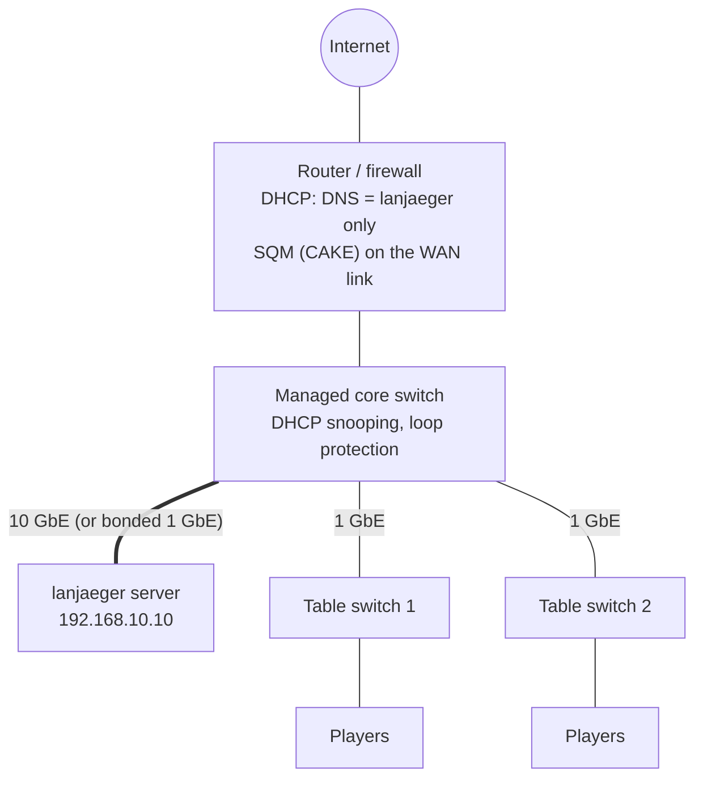

# Setup and test plan

This page has two parts. The [target setup](#1-target-setup) describes what a working lanjaeger installation for a LAN party looks like: hardware, network, IP plan and configuration. The [test plan](#2-test-plan) lists what to check on that setup before the event.

CI already tests much of the stack automatically (see [What CI already covers](#what-ci-already-covers)). The test plan is about what only real hardware, real accounts and real player devices can show.

---

## 1. Target setup

### Network layout



- **One flat, wired party network:** every player in one subnet, because LAN game discovery uses broadcasts. No client isolation, and no VLAN per table.
- **The cache server gets the fastest link:** every download comes from it at once. As a rule of thumb, 1 Gbit/s is enough for about 10 players.
- **Wi-Fi:** only as a separate guest network, if at all.

### Server

| | Minimum | Recommended for 20+ players |
|---|---|---|
| OS | Linux with Docker Engine + Compose v2 (Ubuntu LTS is what lancache tests on) | same |
| CPU / RAM | 4 cores / 8 GB | 8+ cores / 16–32 GB (Linux uses spare RAM as a read cache) |
| Cache disk | SSD | NVMe, or SSDs in RAID 0, dedicated to the cache (not the system disk) |
| Network | 1 GbE | 10 GbE, or bonded 1 GbE ports |
| Address | static, private (192.168.x / 10.x / 172.16–31.x) | same |

### Example IP plan

| What | Address |
|---|---|
| Party subnet | `192.168.10.0/23` (room for about 500 devices including phones) |
| Router (gateway) | `192.168.10.1` |
| lanjaeger server | `192.168.10.10` (`LANCACHE_IP` and `DNS_BIND_IP`) |
| DHCP pool | `192.168.10.100` – `192.168.11.250` |
| Optional IPv6 DNS | `fd00:10::10` (`DNS_BIND_IP6`) |

### `.env` for that plan

Start from `.env.example`. These are the lines that matter:

```bash
LANCACHE_IP=192.168.10.10
DNS_BIND_IP=192.168.10.10
UPSTREAM_DNS=192.168.10.1          # the router, or e.g. 1.1.1.1
CACHE_ROOT=/srv/lancache           # on the cache disk
CACHE_DISK_SIZE=1800g              # ~90% of the disk, gigabytes with g only
CACHE_INDEX_SIZE=500m              # ~250m per 1000g
RESTART_POLICY=unless-stopped      # once everything works
TZ=Europe/Zurich

COMPOSE_PROFILES=webui
WEBUI_PASSWORD=<long random password>
WEBUI_BIND_IP=192.168.10.10        # LAN only
WEBUI_PUBLIC_DASHBOARD=false       # true = stats on a screen without sign-in

# Only if you keep IPv6 on the party network (see NETWORK.md):
#DNS_BIND_IP6=fd00:10::10
#COMPOSE_FILE=docker-compose.yml:docker-compose.ipv6.yml
```

### Router settings

Complete configurations for example networks, including a FortiGate with SD-WAN over two uplinks, are in [examples/](examples/README.md).

- [ ] DHCP hands out **only** `192.168.10.10` as DNS server, with no secondary.
- [ ] IPv6 is off on the party network, **or** the router's announced IPv6 DNS (RDNSS / DHCPv6) is `DNS_BIND_IP6`.
- [ ] Outgoing DNS (UDP/TCP 53) and DNS-over-TLS (853) from the party network is redirected to or blocked except for lanjaeger. lanjaeger itself must still reach `UPSTREAM_DNS`.
- [ ] SQM / smart queue (CAKE, or fq_codel) is on for the WAN link.
- [ ] No port forwarding to the server. The web UI must never be reachable from the internet.

### What runs on the server

| Container | Listens on | Purpose |
|---|---|---|
| `blocky` | `DNS_BIND_IP:53` (+ `DNS_BIND_IP6:53`) | The DNS server clients use: ad blocking, DNS cache, your DNS entries, the check zone |
| `dns` (lancache-dns, BIND 9) | internal only | Answers game download domains with `LANCACHE_IP` |
| `monolithic` | `:80`, `:443` | The cache itself (nginx); passes HTTPS through untouched |
| `logrotate` | — | Keeps `access.log` from filling the disk |
| `webui` | `WEBUI_BIND_IP:8080` | Dashboard, controls, prefill, alerts, `/check` |

These are internal only and never published: Blocky's API (`blocky:4000`, which has no authentication) and the check-zone responder (`webui:5353/udp`).

### Install

```bash
git clone https://github.com/varmox/lanjaeger.git /opt/lanjaeger && cd /opt/lanjaeger
cp .env.example .env && nano .env          # values from above
docker compose up -d --build
docker compose ps                          # all "healthy" / "running" within ~2 minutes
```

Then go through the [test plan](#2-test-plan), and through [NETWORK.md](NETWORK.md) for the switches and on-the-day checks.

---

## 2. Test plan

Run this on the real setup, ideally a week before the event, then again (sections A–C) on the day. Tick each step and note anything unexpected in the [results table](#results).

### A. Server and stack

| # | Step | Expected |
|---|---|---|
| A1 | `docker compose ps` | `blocky`, `dns`, `monolithic`, `webui` healthy; `logrotate` running |
| A2 | On the server: `dig @192.168.10.10 lancache.steamcontent.com +short` | ends with `192.168.10.10` (after a CNAME line) |
| A3 | `dig @192.168.10.10 github.com +short` | a public IP (forwarding works) |
| A4 | `curl -sI http://192.168.10.10/lancache-heartbeat` | `204`, header `X-LanCache-Processed-By` |
| A5 | Open `http://192.168.10.10:8080`, sign in | dashboard loads; "Health" lists all services healthy |
| A6 | Settings page | no warnings (private `LANCACHE_IP`, no DNS loop) |
| A7 | Reboot the server | everything comes back by itself (`RESTART_POLICY=unless-stopped`) |

### B. One player device

Use a normal gaming PC on a table switch, with DHCP left on automatic.

| # | Step | Expected |
|---|---|---|
| B1 | `ipconfig /all` (Windows) | DNS server is `192.168.10.10` only; no IPv6 DNS from the router |
| B2 | Open `http://192.168.10.10:8080/check` | **"Yes — downloads on this device go through the cache"** (6 of 6) |
| B3 | Install a small Steam game the cache hasn't seen | downloads at internet speed; dashboard shows MISS traffic for `steam` |
| B4 | Uninstall it, install again (or on a second PC) | near-LAN speed; dashboard hit rate rises, HIT traffic for `steam` |
| B5 | Same for one Epic game and one Battle.net game | second install fast. Battle.net's first download can be very slow, which is normal: use prefill |
| B6 | Start an EA app / Riot client update | works (HTTPS passes through); a private `LANCACHE_IP` lets them fall back to cacheable HTTP |
| B7 | Clients page | the PC's IP appears with its traffic |

### C. The check page catches misconfigured devices

| # | Step | Expected |
|---|---|---|
| C1 | On the test PC set DNS manually to `8.8.8.8`, run `/check` | **"No"** with fix steps |
| C2 | Set DNS to `192.168.10.10` + `8.8.8.8` | **"Partly"** (or "No", depending on the OS's resolver order) |
| C3 | Back to automatic, but Firefox with DNS over HTTPS forced on | **"No"**, pointing at browser encrypted DNS |
| C4 | A phone and a Mac on the party network | "Yes". If "Partly", the router still announces IPv6 DNS: fix the router (see NETWORK.md) |
| C5 | If using IPv6 DNS: device with IPv6 on, router announcing `DNS_BIND_IP6` | "Yes" |

### D. Ad blocking

| # | Step | Expected |
|---|---|---|
| D1 | Ad blocking page | Status "Blocking", blocklist with tens of thousands of domains |
| D2 | `nslookup doubleclick.net 192.168.10.10` | `NXDOMAIN` (blocked) |
| D3 | Browse a few ad-heavy sites | ads gone; "Blocked (24 h)" rises |
| D4 | Click **Allow** on a blocked domain | it resolves again within about a minute |
| D5 | Pause 5 min | `doubleclick.net` resolves; blocking resumes on its own after 5 min |
| D6 | Switch off, then `docker compose restart blocky` | stays off within about a minute (the web UI re-applies it) |
| D7 | Launch a few games and launchers people will use, and log in | nothing breaks. Anything that does: Allow its domain |

### E. DNS entries

| # | Step | Expected |
|---|---|---|
| E1 | Add `lanjaeger.lan → 192.168.10.10`, save | within about a minute `nslookup lanjaeger.lan` answers it; "Test a name" shows "Your DNS entries" |
| E2 | Add an invalid entry (`printer.local`, `10.0.0.999`) | rejected with a message on that row; nothing saved |
| E3 | **Apply now** | DNS gone for about 2 s, then the entry works immediately |

### F. Prefill

| # | Step | Expected |
|---|---|---|
| F1 | Steam → Log in. Answer username, password, Steam Guard | "Logged in to Steam". If Steam asks for **approval in the mobile app** instead of a code, note it: that path hasn't been tested yet |
| F2 | Select one small Steam game, Prefill now | log shows the download; dashboard shows MISS traffic from the server itself |
| F3 | Install that game on a player PC | fast from the start (HIT) |
| F4 | Epic → Log in via `legendary.gl/epiclogin` and `authorizationCode` | "Logged in to Epic"; Refresh library lists your games |
| F5 | Select one small Epic game, prefill, install on a PC | HIT |
| F6 | Battle.net: tick one product, prefill | finishes; later install is fast |
| F7 | Schedule for 2 minutes from now | runs on its own at that time |
| F8 | Start a prefill, press **Stop** | stops; no "Prefill failed" alert |
| F9 | Run prefill again | only changed games are downloaded |

### G. Alerts

| # | Step | Expected |
|---|---|---|
| G1 | Set up ntfy / Discord / email, **Send test alert** | each channel shows "sent" and the message arrives |
| G2 | `docker compose stop logrotate`, wait 5+ min | "logrotate is exited" arrives; banner on the dashboard |
| G3 | `docker compose start logrotate` | "Resolved: …" arrives within a minute or two |
| G4 | Set the disk threshold below current usage | "Cache disk almost full" arrives; set it back, "Resolved" |
| G5 | Make a prefill fail (e.g. log out of Steam, keep it enabled, Prefill now) | "Prefill failed" with the log tail |

### H. Load (closer to the event)

| # | Step | Expected |
|---|---|---|
| H1 | Prefill the games people will play | done the night before |
| H2 | 4–5 PCs install the same prefilled game at once | total throughput near the server's link speed (about 110 MB/s per 1 GbE); dashboard "Downloading now" matches |
| H3 | Meanwhile run `htop` / `iostat -x 2` on the server | disk not at 100% busy all the time; CPU not maxed out |
| H4 | Meanwhile play an online game on another PC | ping stays stable (SQM works) |
| H5 | Core switch port counters | no errors or drops on the server port |
| H6 | With two uplinks (SD-WAN): watch both WAN interfaces during H1 | cache misses use **both** links (FortiGate: tests FG1–FG7 in [examples/fortigate.md](examples/fortigate.md#6-check-that-it-works)) |

### I. Security and failure behaviour

| # | Step | Expected |
|---|---|---|
| I1 | From outside (mobile data): try `http://<your public IP>:8080` | not reachable |
| I2 | From a player PC: `nmap -p 4000,8080 192.168.10.10` and `nmap -sU -p 5353 192.168.10.10` | 4000 closed (Blocky's API); 5353/udp closed (check responder); 8080 open only on `WEBUI_BIND_IP` |
| I3 | 5 wrong passwords in the web UI | locked out for 5 minutes |
| I4 | `docker compose stop webui` | DNS and downloads keep working; only `/check` and the UI are gone |
| I5 | Unplug the WAN, try installing a cached game | note what happens. The files are local, but launchers usually still need the internet for login and download manifests, so this mainly shows how each launcher behaves |
| I6 | Set `LOG_MAX_SIZE_MB=10` temporarily, download a bit | `access.log` gets rotated into `access.log.1.gz` |

### What CI already covers

Every push runs these automatically, so they don't need retesting by hand:

- **Backend unit tests (61):** log parsing, settings validation, sign-in and lockout, the cross-site request check, ad-block lists, prefill settings and scheduler, the Epic token rules, the alert state machine, DNS entries, and the check-zone DNS responder.
- **Builds:** the frontend build and the web UI Docker image, with a smoke test.
- **Configuration:** compose files (with and without the web UI and IPv6), shell scripts, Blocky's own config validation, and log rotation in the real `busybox` image.
- **Integration with real containers (Blocky + lancache-dns + web UI):**
  - game domains resolve to the cache IP and other names are forwarded;
  - the check zone answers through Blocky, and a full check counts 6 of 6;
  - a DNS entry saved in the web UI goes live without a restart;
  - Blocky doesn't log queries.

**Not covered by CI, and why the test plan exists:** the monolithic cache serving real downloads, real Steam/Epic/Battle.net logins and prefills, real alert delivery, real player devices and routers (IPv6, encrypted DNS), and throughput under load.

### Results

Copy this into an issue or a note for each test round:

| Date | Section | Passed | Problems / notes |
|---|---|---|---|
| | A | | |
| | B | | |
| | C | | |
| | D | | |
| | E | | |
| | F | | |
| | G | | |
| | H | | |
| | I | | |
