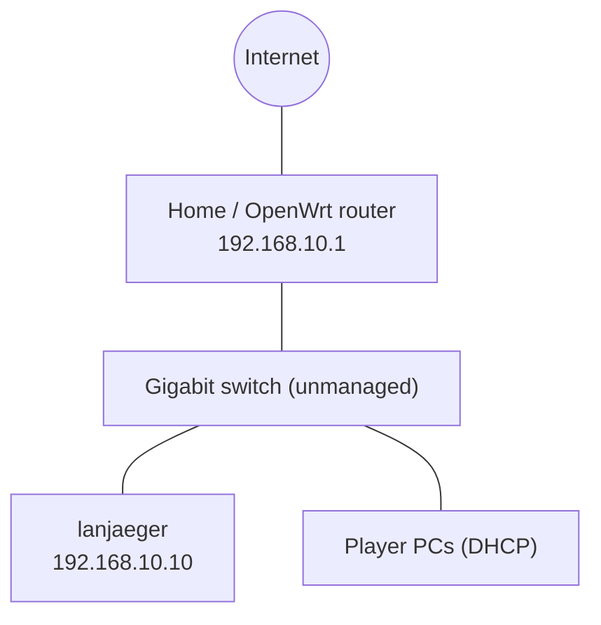
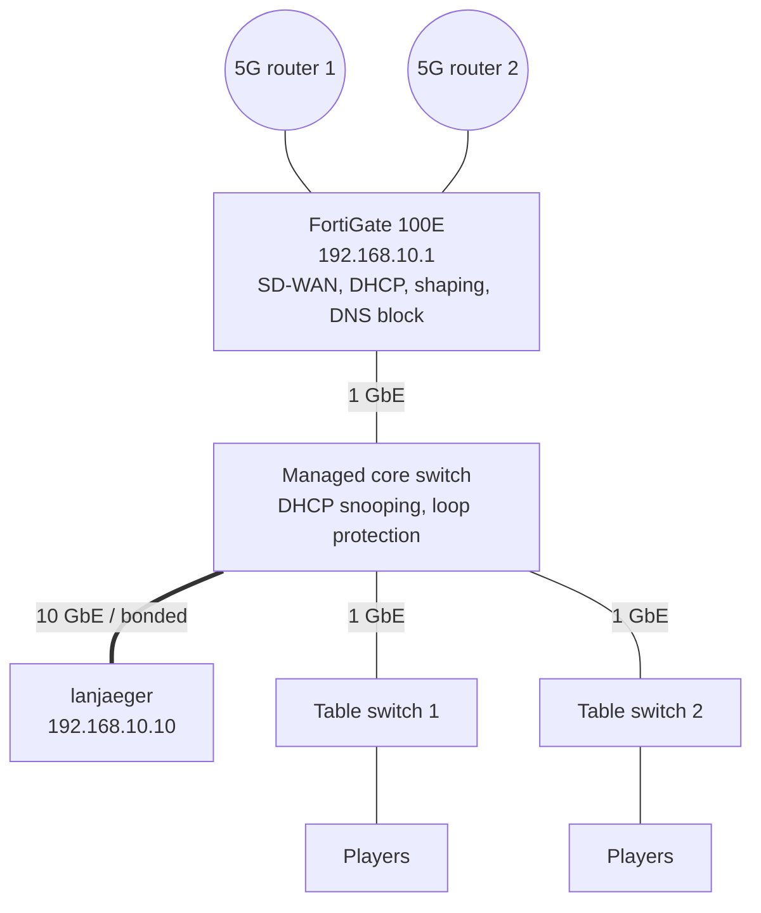

# Example networks

Two example setups for lanjaeger at a LAN party, with the router configuration each one needs. Both use the same IP plan as [SETUP.md](../SETUP.md). Adjust the addresses to your network.

| | [A. Small party](#a-small-party-up-to-about-10-players) | [B. Large party with FortiGate](#b-larger-party-fortigate-with-two-5g-uplinks) |
|---|---|---|
| Players | up to about 10 | 20–60 |
| Router | consumer or OpenWrt router | FortiGate 100E, SD-WAN over two 5G uplinks |
| Switches | one unmanaged gigabit switch | managed core switch + table switches |
| Cache server link | 1 GbE | 10 GbE (or bonded 1 GbE) to the core switch |
| Router config | [below](#router-settings-for-a) | [fortigate.md](fortigate.md) |

Whatever the router, these settings matter most, in this order (details in [NETWORK.md](../NETWORK.md)):

1. DHCP hands out lanjaeger (`DNS_BIND_IP`) as the **only** DNS server.
2. IPv6 on the party network is off, or announces lanjaeger's `DNS_BIND_IP6` as its DNS.
3. The cache server has a static, private IP.
4. Downloads that miss the cache don't ruin everyone's ping: traffic shaping / SQM.
5. Players can't bypass lanjaeger with hard-coded DNS: outgoing DNS (53) and DNS-over-TLS (853) are blocked or redirected.

---

## A. Small party (up to about 10 players)



Players and the cache are on the same switch, so cache downloads never pass through the router. A single 1 GbE link from the server is enough for about 10 players.

### Router settings for A

| Setting | Value |
|---|---|
| LAN subnet | `192.168.10.0/24` (or `/23` if many phones join) |
| DHCP: DNS server | `192.168.10.10` only — leave secondary DNS empty |
| DHCP reservation / static IP | lanjaeger = `192.168.10.10` |
| IPv6 on the LAN | off (or RDNSS → `DNS_BIND_IP6`, see NETWORK.md) |
| SQM | CAKE, set to about 90% of the measured line speed |
| Port forwarding | none |

On **OpenWrt** that is:

```sh
uci add_list dhcp.lan.dhcp_option='6,192.168.10.10'   # DHCP option 6 = DNS server
uci set dhcp.lan.ra='disabled'                         # no IPv6 router advertisements on the LAN
uci set dhcp.lan.dhcpv6='disabled'
uci commit dhcp && service dnsmasq restart && service odhcpd restart
```

and SQM via the `luci-app-sqm` package (queue discipline `cake`, script `piece_of_cake.qos`) on the WAN interface ([OpenWrt SQM guide](https://openwrt.org/docs/guide-user/network/traffic-shaping/sqm)).

On routers without these options (many ISP routers, e.g. a FRITZ!Box without SQM): set the DNS server in DHCP if possible, otherwise put a second router behind it for the party network, or let lanjaeger's host run the DHCP server instead.

---

## B. Larger party: FortiGate with two 5G uplinks



The core switch carries all LAN traffic, including the big cache downloads. The FortiGate only sees internet traffic, which matters because the 100E's throughput with security profiles turned on is only a few hundred Mbit/s.

All the FortiGate configuration is in **[fortigate.md](fortigate.md)**: DHCP, SD-WAN, firewall policies, DNS bypass blocking, traffic shaping, and how to check that it works.
